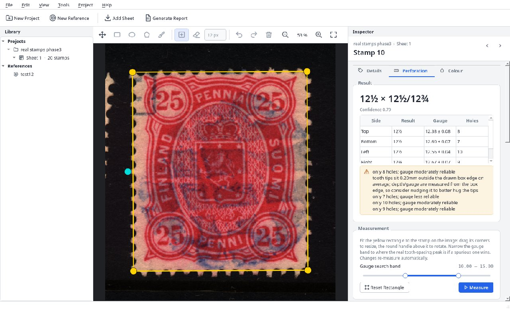
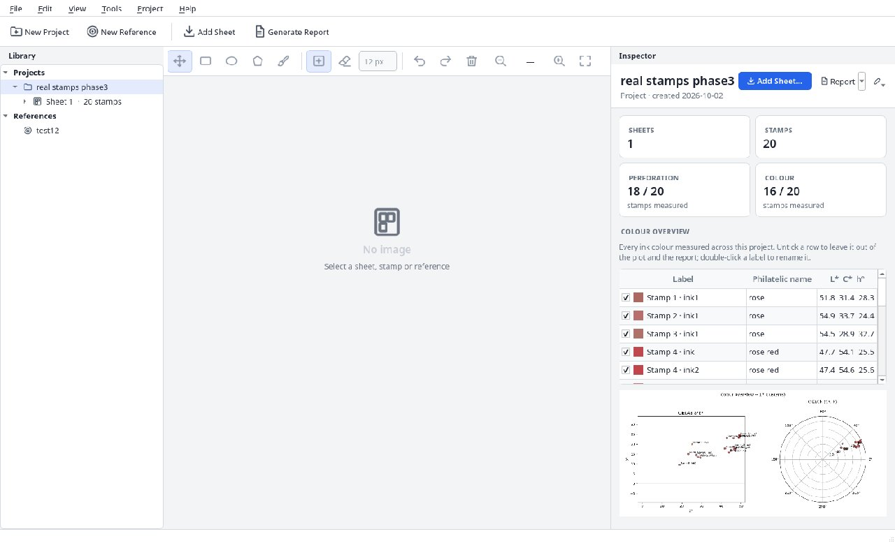
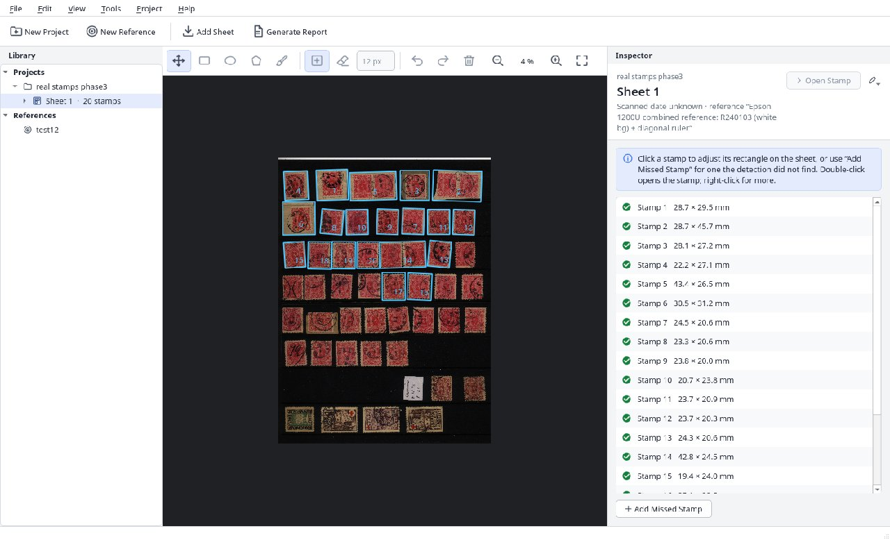
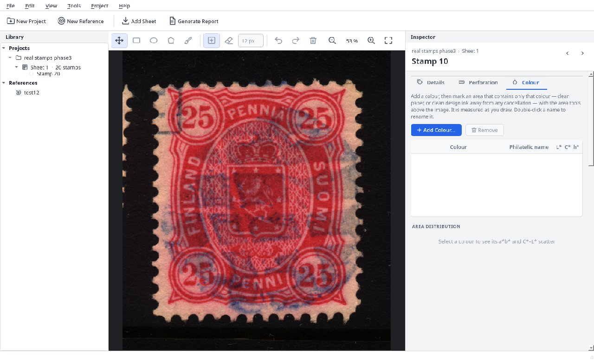
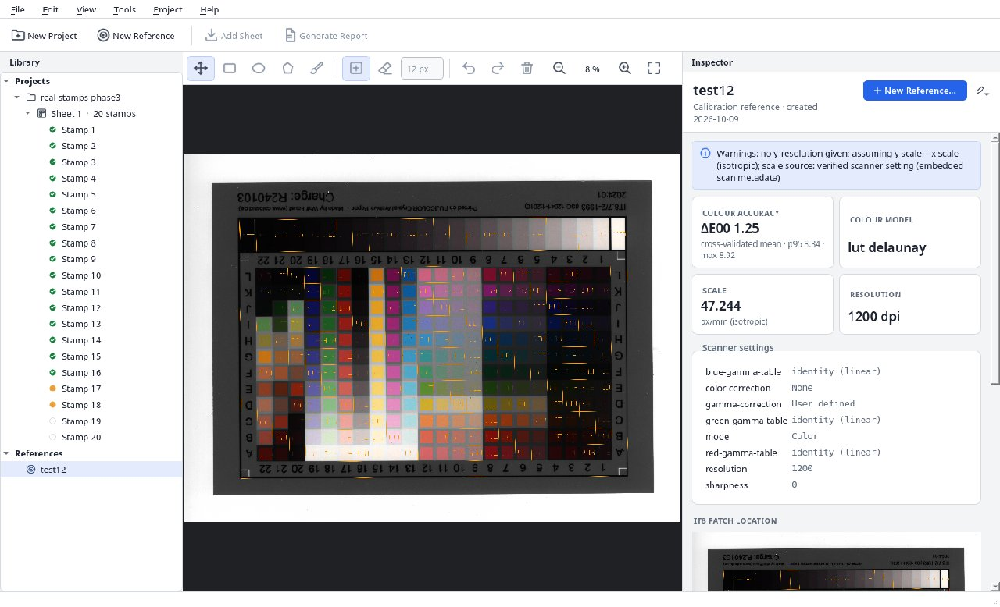

<p align="center">
  
</p>

<h1 align="center">Stamp Analyzer</h1>

<p align="center">
  Calibrated measurement of postage stamps from flatbed scans:<br>
  perforation gauge per side, and ink/paper colour in CIELAB D50 with ΔE00 and philatelic colour names.
</p>

> [!IMPORTANT]
> **This whole project was written by AI.** Every line of code, every test, the GUI, the icons,
> the report templates, the design documents and this README were written by
> **[Claude](https://www.anthropic.com/claude)** (Anthropic's AI model), working in
> [Claude Code](https://claude.com/claude-code).
> The human side of the collaboration, [René](https://github.com/Limhes), is a philatelist with
> a background in instrumentation and chemistry. He set the requirements and the scientific
> direction, supplied the scanner, the IT8 target and the stamps, tested every phase on real
> hardware and reviewed the results. He did not write the code.



---

## What it does

Philatelists tell stamps apart by two properties that are hard to judge by eye: the **perforation
gauge** (the number of teeth per 2 cm) and the **shade** of the ink. Stamp Analyzer measures both
from a flatbed scanner whose geometry and colour response have been calibrated, and it reports
how sure it is about every number.

| | |
|---|---|
| **Calibration** | Scan an IT8.7/2 target once. The patches are found automatically (ArgyllCMS `scanin`, at any position or rotation on the bed). Several colour models are fitted and cross-validated, and the best one is kept. That gives a *reference* that maps scanner RGB → CIE XYZ D50 → CIELAB. Scale comes from the verified scanner resolution, with x and y kept separate. |
| **Sheets** | Scan a whole stock card of stamps with exactly the reference's settings (applied *and read back* before scanning). Every stamp is detected and cropped upright automatically. Rectangles can be corrected, and missed stamps can be added by hand. |
| **Perforation** | The gauge is measured per side from the tooth profile (spectral peak cross-checked against hole positions), with uncertainty, hole count, compound perforations (e.g. `12½ × 12½/12¾`), imperforate and straight-edge detection, and a diagnostic image for every side. |
| **Colour** | Mark an area of clean ink or paper. It is measured in CIELAB/LCh D50 with spread (ΔE00) and given the nearest philatelic colour name ("rose red", "grayish vermilion", …). A project-wide overview compares every shade in a*b* and C\*h. |
| **Report** | A PDF with one page per stamp (crop, perforation diagnostics, colour table), a colour overview of all stamps, and CSV/JSON exports. |

### Design principles

- **No invented results.** Every measurement carries a confidence and explicit warnings
  (*"only 7 holes; gauge less reliable"*). If an algorithm isn't sure, it says so instead of
  returning a plausible-looking number.
- **Every step shows what it saw.** Detected edges, holes, profiles, spectra, masks and patch
  grids are saved as diagnostic images. They are part of the output, not debug leftovers.
- **Physics first.** Colour maths runs in float64 on linear scanner RGB, with the scanner's own
  processing switched off (identity gamma tables, no colour correction or sharpening). Physical
  units always come from the calibration, never from a hard-coded dpi. 8-bit sRGB is only used
  for display.
- **Traceable.** Each reference records the exact scanner settings it was made with. Manual
  corrections are stored next to the automatic result and never overwrite it.

## Screenshots

| Project overview | Sheet with detected stamps |
|---|---|
|  |  |
| **Colour measurement** | **Calibration reference** |
|  |  |

## Installation

Requirements: Linux, Python 3.12, [uv](https://docs.astral.sh/uv/), and the following system packages:

```bash
sudo apt install argyll argyll-ref sane-utils
```

- **ArgyllCMS** (`argyll`, `argyll-ref`) is required: `scanin` locates the IT8 patches.
- **SANE** (`scanimage`) is needed only for scanning from inside the app. You can also import TIFF scans.
- WeasyPrint (PDF reports) needs Pango; see the [WeasyPrint docs](https://doc.courtbouillon.org/weasyprint/stable/first_steps.html) if PDF output fails.

```bash
git clone https://github.com/Limhes/stamp_analyzer.git
cd stamp_analyzer
uv sync --extra gui
```

## Usage

### GUI

```bash
uv run stampan-gui
```

1. **New Reference…** Scan (or load) an IT8.7/2 target, review the fit (cross-validated ΔE00
   per candidate model and the patch-location diagnostic), then save.
2. **New Project…**, then **Add Sheet…** Scan a stock card or import a 16-bit TIFF. The stamps
   are detected and listed under the sheet.
3. Open a stamp:
   - *Perforation*: fit the rectangle to the stamp. It re-measures as you edit.
   - *Colour*: add a colour (e.g. "paper", "frame") and draw its area.
4. **Generate Report** writes the PDF, CSV and JSON into the project folder.

Right-drag pans the image and the mouse wheel zooms. F2 / Delete rename or remove the item
selected in the library. **Edit ▸ Preferences** sets the library folder, the default scanner and
the capture settings for new references.

### Command line

The whole pipeline also runs headless:

```bash
uv run stampan scanner-info                 # list scanners and their options
uv run stampan reference --help             # build / list / inspect references
uv run stampan scan --help                  # verified scan with a reference's settings
uv run stampan run --help                   # detect → perforation → colour → report
uv run stampan report --help
```

## Project layout

```
src/stampan/
  core/          # pure Python, no Qt: calibration, detection, perforation, colour, report
    workflow.py  # end-to-end steps shared by the CLI and the GUI
  cli.py         # `stampan`
  gui/           # `stampan-gui` (PySide6): main window, pages, dialogs, viewer, theme, icons
reference_data/  # IT8 target reference data (CGATS)
docs/SPEC.md     # the full design
docs/PHASES.md   # development phases, acceptance criteria and status notes
tests/
```

`docs/SPEC.md` is the authoritative design document: the algorithms, the colour science, the
known limitations of flatbed measurement, and what was tried and dropped (for example
cancellation segmentation).

## Development

```bash
uv run pytest                                  # test suite (incl. an offscreen GUI smoke test)
uv run ruff check . && uv run ruff format .
```

## How this was built

The project was built phase by phase in conversation with Claude, following `docs/PHASES.md`:
data model and IT8 parsing → scanner capture and calibration → stamp detection → perforation →
colour → report → GUI → scanner and reference management in the GUI → refactor. After each phase
Claude reported validation numbers and diagnostic images. René then tested the result on his own
scanner and stamps, and decided what to change next. Several of those decisions are recorded in
the spec, for example replacing a ruler with the verified scanner resolution, replacing manual
corner clicks with `scanin`, and dropping ISCC–NBS names in favour of philatelic ones.

So the code is AI-written, and the requirements, the measurements on real stamps and the
judgement calls are human. Please review it as you would any other code before relying on its
numbers. It is a measurement tool, and its warnings are there for a reason.

## Licence

No licence has been chosen yet. Until one is added, all rights are reserved by the repository owner.
